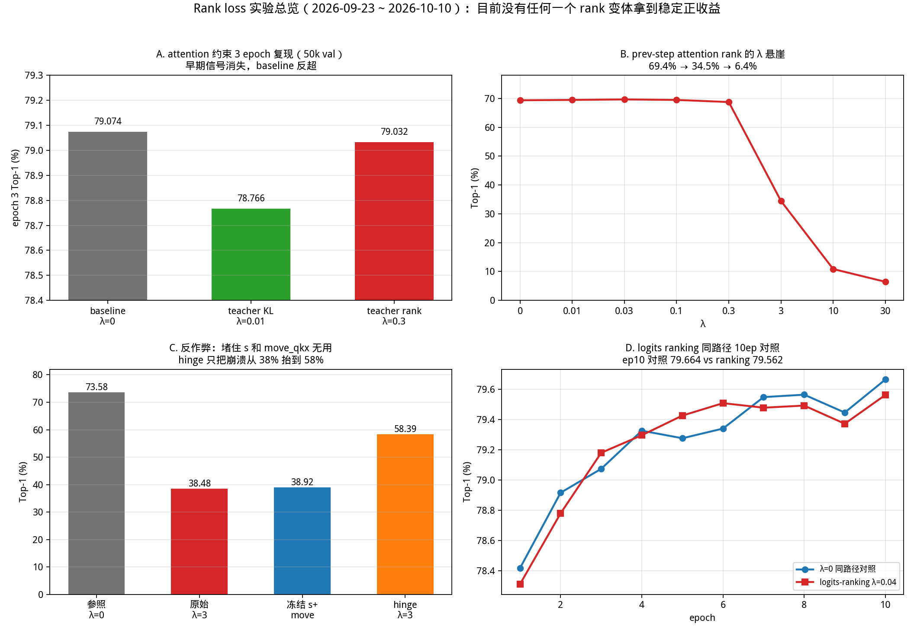
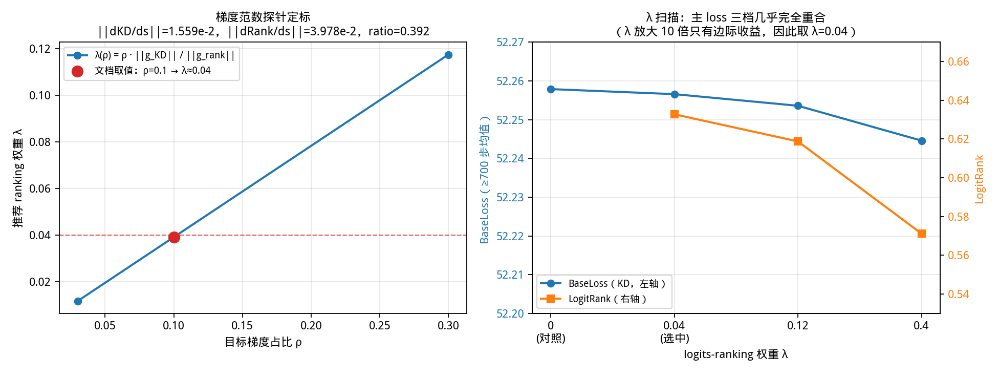
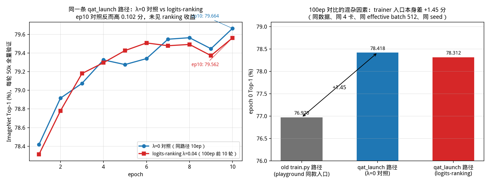
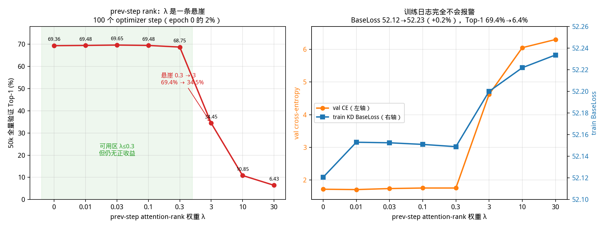
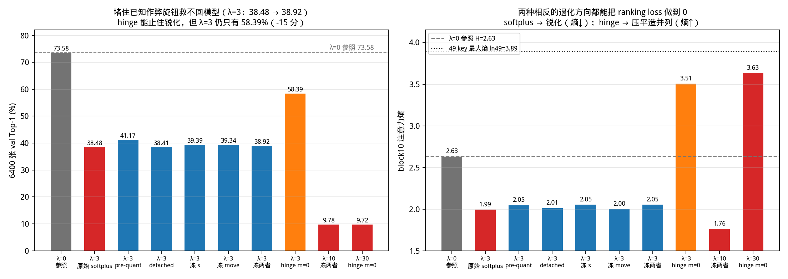
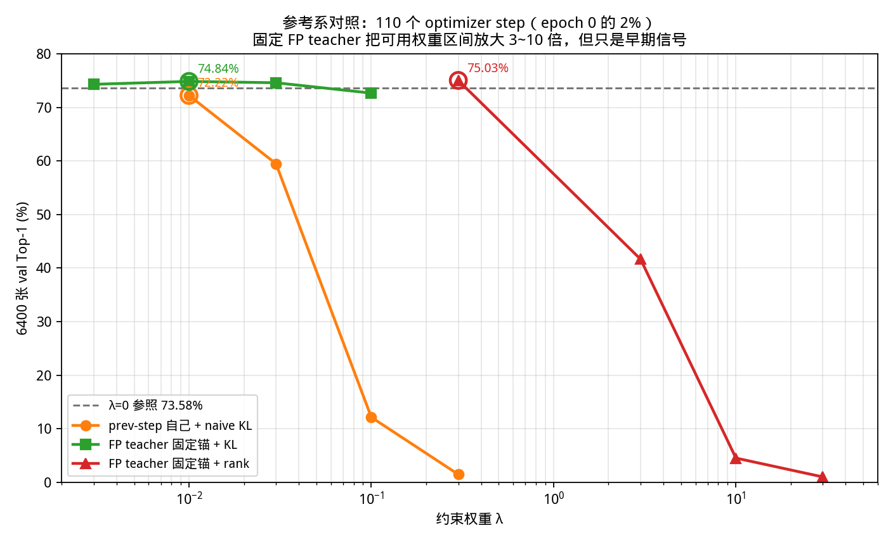
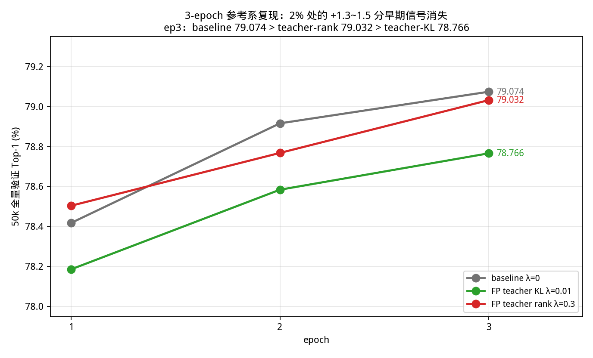

# Rank Loss 实验总报告（2026-09-23 ~ 2026-10-10）

> **2026-10-22 更新**：teacher-anchored attention rank（w=0.3）的 100 epoch 长跑已完成：best **80.8720 @ep92**，逐 epoch 配对平均比本地 logit-rank λ=0.04 曲线低 0.098 分，100 轮只胜 17 轮，仍无正收益证据。纯 λ=0 的 100ep 同栈对照依然缺失。对训练目标、排序损失退化通道与 STE 的结构性分析见
> [qat_objective_attention_oscillation_ste_audit_20261022.md](qat_objective_attention_oscillation_ste_audit_20261022.md)。

> **范围**：自提交 `c58e9a6`（2026-09-23 引入分类 logits ranking）以来，所有与 rank loss 有关的实现、定标、短跑、长跑、反作弊与参考系对照实验。
>
> **一句话结论**：两条 rank 路线目前都没有拿到**可复现的正收益**。
> 分类 logits ranking 的 100 epoch 表面领先（+0.12~0.15 分）无法归因给 rank loss：同路径 10 epoch 对照没有复现（λ=0 比 ranking 高 0.102 分），且这批对比跨了 trainer 入口（入口差 +1.45 分）；
> attention-relation ranking 在 prev-step 自参考下是一条 λ 悬崖，堵住已知作弊旋钮、改 pre-quant / detached、冻结 `s` 与 `move_qkx_*`、换 hinge 都不能修复；
> 换成固定 FP teacher 后，2% epoch 处有 +1.3~1.5 分的早期信号，但 3 epoch 全量验证时消失（ep3 baseline 79.074 > teacher-rank 79.032 > teacher-KL 78.766）。

---

## 0. 总览



### 0.1 实验总表

| 路线 | 实验 | 训练口径 | 评测口径 | 关键结果 | 结论 |
|---|---|---|---|---|---|
| logits ranking | 单元/端到端冒烟 | 400 micro-step | 训练日志 | loss 0.777→0.484（DeiT）/0.700→0.241（Swin），valid pairs ≈1.6e5 | 实现正确，开销 +1.3~1.5% |
| logits ranking | 梯度探针 + λ 扫描 | 700~1500 步 | 训练日志 | `\|\|dRank/ds\|\|/\|\|dKD/ds\|\|=0.392`；λ=0.04/0.12/0.4 的 BaseLoss 52.2579/52.2566/52.2536/52.2446 | 主目标不敏感，取 λ=0.04 |
| logits ranking | 4×3090 100 epoch | 100 ep，effective batch 512 | 每 epoch 50k 全量 | best 80.9380 @ep94（baseline 80.7920 @ep82，teacher-KL 80.8180，self-KL 80.7720） | 表面 +0.12~0.15，**但有 trainer 入口混杂** |
| logits ranking | **同路径 λ=0 10ep 对照** | 10 ep，完全同配方 | 每 epoch 50k 全量 | ep10：对照 79.6640 vs ranking 79.5620（**对照高 0.102**） | **同路径上没有看到 rank 收益** |
| logits ranking | old trainer 1ep 对照 | 1 ep | 50k 全量 | old `train.py` 路径 76.97 vs `qat_launch` 路径 78.418 | trainer 入口本身差 **+1.45 分**，100ep 跨入口对比不成立 |
| attention rank | prev-step λ 扫描 | 100 optimizer step（epoch 0 的 2%） | 50k 全量 | λ=0.03 最好 69.6500；λ=0.3 68.7480；λ=3 **34.4520**；λ=10 10.8540；λ=30 **6.4320** | **λ 悬崖**，可用区 λ≤0.3 且无正收益 |
| attention rank | 根因分析 | step 100 checkpoint 对比 | 6400 张 val | λ=30：Top-1 6.89%，H(block8/10/11) 2.6→1.7；`quan_a_softmax_fn.s` 缩到 0.51~0.68× | softplus 无 margin + 自参考 → 注意力锐化 |
| attention rank | 反作弊（s / move_qkx / hinge） | 110 optimizer step | 6400 张 val | λ=3：原始 38.48 → 冻结 s 39.39 → 冻结 move_qkx 39.34 → 冻结两者 38.92；hinge λ=3 58.39 | **堵参数是打地鼠；hinge 也救不回** |
| attention rank | 参考系对照（2% epoch） | 110 optimizer step | 6400 张 val | prev-step KL λ=0.01 72.22；teacher-KL λ=0.003~0.1 74.30/74.84/74.59/72.66；teacher-rank λ=0.3 **75.03** | 固定锚把可用区间放大 3~10 倍，**但只是早期信号** |
| attention rank | **3 epoch 参考系复现** | 3 ep = 7509 optimizer step | 每 epoch 50k 全量 | ep3：baseline **79.074**，teacher-rank 79.032，teacher-KL 78.766 | **2% 处的早期信号消失，baseline 反超** |

### 0.2 统计口径提醒

本报告里的所有 Top-1 都来自单 seed 的 ImageNet val 子集或全量：

| 评测集 | 单点 binomial 标准误（Top-1≈74~79%） | 读法 |
|---|---:|---|
| 50,000 张全量 val | ≈0.18~0.20 分 | 小于 0.2 分的差异不能单独作为收益证据 |
| 6,400 张 val 子集 | ≈0.55 分（Top-1≈74%）；≈0.61 分（Top-1≈38%） | 小于 0.6 分的差异基本是噪声 |

另外全部短跑是**单 seed**：seed 间的轨迹噪声没有进入误差棒。因此：

- λ=3 从 69.4% 掉到 34.5%、λ=30 掉到 6.4% 这种量级的结论是硬的；
- 100 epoch 的 +0.1 分、2% epoch 的 +1.3 分、3 epoch 的 -0.04 分都必须打折看；
- 只有“同一入口、同一 seed、同一评测集、同一训练步数”的 A/B 才能支持收益结论。

---

## 1. 背景：两条 rank 路线

`rank_idea/logits-ranking-ptq.md` 与 `rank_idea/logits-ranking-ptq-explained.md` 最初描述的是**逐块量化重构（PTQ）**里的排序监督：

- 教师给 top-k 类别的顺序，学生保持同样的顺序；
- 损失用成对 `softplus(-Δ)`，其中 `Δ = log s_c - log s_d`；
- PTQ 场景里每个块还有 Fisher / Hessian 的块输出重构项兜底，所以排序项不会把块输出带跑。

迁到本仓库的 QAT 全模型训练时，实验分成了两条线：

| 路线 | 排序对象 | 参考 | 损失 | 主要动机 |
|---|---|---|---|---|
| 分类 logits ranking | 最终分类 logits 的类别顺序 | FP teacher 的 logits | `softplus(-(s_c-s_d))`，top-5 | 在 KD 之外补一个“类别顺序”约束，几乎不增加算力 |
| attention-relation ranking | 每个 (layer, head, query) 行内的 key 顺序 | prev-step 自己 / FP teacher 的 attention | `softplus(-Δ)` / `relu(m-Δ)` | 直接压制注意力震荡，替代此前效果很弱的 attention-KL |

两条路线都在 `qat_launch.py` 里有独立开关，并且都默认关闭：

```text
--logit-rank-weight / --logit-rank-topk
--attn-rank-weight / --attn-rank-source {teacher,ref} / --attn-rank-topk
--attn-rank-min-attn / --attn-rank-target / --attn-rank-hinge / --attn-rank-margin
```

---

## 2. 提交与资产索引

### 2.1 rank loss 相关提交（旧 → 新）

| commit | 内容 |
|---|---|
| `3f4d428` | DeiT-Tiny 单卡冒烟路径与 Swin-T 速度对比 |
| `908d033` | 打开 DeiT attention 采集，加入 attention-relation ranking loss |
| `eccb5c0` | attention-relation ranking 抽成 DeiT/Swin 共用模块 |
| `c58e9a6` | **加入分类 logits ranking loss（DeiT + Swin）与 100ep 时长估计** |
| `6d13c69` | 4-GPU 100 epoch Swin-T W4A4 logits-ranking 启动脚本与实测估计 |
| `886a3be` | 梯度探针 + λ 扫描，把 logits-ranking 权重定到 λ=0.04 |
| `692d361` | prev-step attention-relation ranking（block 8-11 全 head）+ 记录 λ 悬崖 |
| `3803d9a` | attention-relation ranking 反作弊实验：堵住已知杠杆没用 |
| `6c14c0a` | 参考系消融：prev-step 自己 vs 固定 FP teacher |

### 2.2 原始日志与脚本

| 内容 | 路径 |
|---|---|
| logits ranking 方法、λ 定标、100ep 估计 | `docs/deit_tiny_w4a4_smoke_and_speed_20260923.md` |
| attention rank 第一轮：λ 悬崖与根因 | `docs/attn_relation_ranking_qat_prevstep_l8to11_failure_20261008.md` |
| attention rank 第二轮：反作弊 + 参考系消融 | `docs/attn_relation_ranking_qat_anticheat_experiments_20261008.md` |
| 100ep logits-ranking 启动脚本 | `tmp_scripts/run_swin_w4a4_100ep_logitrank_4gpu_20260924.sh` |
| 100ep logits-ranking 原始日志（4×3090） | `/datadisk2/quyanyi/qat_runs/ofq_swin_t_w4a4_100ep_logitrank_20260924.log` |
| 同路径 λ=0 10ep 对照脚本 / 日志 | `tmp_scripts/run_swin_w4a4_lambda0_control_10ep_4gpu_20260929.sh`；`/datadisk2/quyanyi/qat_runs/ofq_swin_t_w4a4_lambda0_control_10ep_20260929.log` |
| old trainer 1ep 复现脚本 / 日志 | `tmp_scripts/run_oldtrain_path_1ep_4gpu_20260929.sh`；`/datadisk2/quyanyi/qat_runs/oldtrain_path_1ep_repro_20260929.log` |
| logits-ranking λ 扫描脚本 | `tmp_scripts/sweep_swin_w4a4_logitrank_weight_4gpu_20260924.sh` |
| attention rank 主启动脚本 | `tmp_scripts/run_swin_w4a4_attnrank_prevstep_l8to11_4gpu_20261008.sh` |
| attention rank λ 扫描脚本 | `tmp_scripts/sweep_swin_w4a4_attnrank_weight_20261008.sh` |
| 逐张量梯度分解 | `tmp_scripts/analyze_attnrank_parameter_gradients_20261008.py` |
| checkpoint 对比（Top-1 / 熵 / 逐张量范数） | `tmp_scripts/analyze_attnrank_failure_checkpoints_20261008.py` |
| 3 epoch 参考系复现脚本 | `tmp_scripts/run_swin_w4a4_3ep_reference_ablation_4gpu_20261009.sh` |
| 3 epoch 日志 | `/datadisk2/quyanyi/qat_runs/swin3ep_20261009_{baseline,teacherkl,teacherrank}.log` |
| 100ep 四路曲线图脚本 | `tmp_scripts/plot_swin_w4a4_100ep_logitrank_vs_three_paths_20260928.py` |
| 本报告图表生成脚本 | `tmp_scripts/plot_rank_loss_report_figures_20261014.py` |

参考系消融与反作弊实验的详细逐项数据见两份专门文档；本报告只做汇总、交叉对照与结论。

---

## 3. 分类 logits ranking（2026-09-23 ~ 2026-09-30）

### 3.1 实现与正确性

模块：`third_party/OFQ/src/logits_ranking.py`

```python
logits_ranking_loss(student_logits, teacher_logits, topk=5)   # -> (loss, valid_pairs)
```

规则：

1. 取教师每个样本分数最高的 top-k 个**类别**；
2. 每个 top-k 类别与所有教师分数严格更低的类别组成有向对；
3. 用 `softplus(-(s_c - s_d))` 要求学生保持同样顺序；
4. 并列对不计入，先按样本内有效对平均，再对样本平均；
5. DeiT 蒸馏模型返回 `(cls, dist)` 时取 `cls`，与仓库既有 KD 辅助函数一致。

单元级验证（记录在 `docs/deit_tiny_w4a4_smoke_and_speed_20260923.md` §7）：

| 检查 | 结果 |
|---|---|
| 同序 / 反序 | loss 0.151 / 2.484 |
| C=6，top-5 / top-1 / top-2 | 15 / 5 / 9 对每样本 |
| 并列 | 被排除 |
| 梯度方向 | 高排名类别为负，低排名为正 |
| `(cls, dist)` 元组 | 正常 |

端到端 400 micro-step：

| 模型 | valid pairs | LogitRank 起点 → 终点 |
|---|---:|---:|
| DeiT-Tiny | 159,510（4,985 对/样本 × 32） | 0.777 → 0.484 |
| Swin-T | 159,509（极少数并列） | 0.700 → 0.241 |

### 3.2 开销

同一时段 A/B（同一张 3090）：

| 模型 | 基线 s/step | +logits ranking | 相对开销 |
|---|---:|---:|---:|
| DeiT-Tiny | 0.228 | 0.231 | **+1.3%** |
| Swin-T | 0.331 | 0.336 | **+1.5%** |

张量规模只有 `[B, k, C] ≈ 1.6e5` 个元素，可以认为几乎免费。

### 3.3 λ 定标：梯度探针 + λ 扫描



**梯度范数探针**（真实配方 bs32 + 预训练学生/教师 + KD T=2.75）：

```text
LogitRank grad probe: ||dKD/ds||=1.5586e-02  ||dRank/ds||=3.9782e-02  ratio=0.392
lambda(rho=0.03)=0.0118   lambda(rho=0.1)=0.0392   lambda(rho=0.3)=0.1175
```

按 ρ=0.1 取 **λ≈0.04**。注意 KD 在初始化时梯度很小（量化学生与 FP 教师非常接近），按“损失数值比”直觉给 λ=1 会过强 25 倍。

**λ 扫描**（4 卡并行，每档同一 seed、同一数据顺序、有效 batch 512）：

| λ | BaseLoss（≥700 步均值） | LogitRank（≥700 步均值） |
|---:|---:|---:|
| 0（对照） | 52.2579 | — |
| **0.04** | 52.2566 | 0.6328 |
| 0.12 | 52.2536 | 0.6188 |
| 0.4 | 52.2446 | 0.5712 |

结论：KD 主轨迹在各 λ 下只看得到第 3 位小数（λ=0.4 也只差 0.013），ranking loss 在 λ=0.04 已明显下降，再放大 10 倍只有边际收益，因此取 **λ=0.04**。

> 扫描脚本里 `--max_train_updates` 现在按**优化步**计数（不是 micro-step），这一点在当时踩过坑。

### 3.4 100 epoch 长跑：表面领先，但存在 trainer 入口混杂


4×3090、bs32/卡、accum=4（有效 batch 512）、KD T=2.75、W4A4 + QK-reparam、λ=0.04、top-5、100 epoch。

四条曲线的 best / last：

| 路径 | 入口 | best | best epoch | last |
|---|---|---:|---:|---:|
| 不开 KL（基线） | playground 8×H100 old trainer | 80.7920 | 82 | 80.6780 |
| 自参考 KL | playground 8×H100 old trainer | 80.7720 | 100 | 80.7720 |
| FP teacher KL | playground 8×H100 old trainer | 80.8180 | 100 | 80.8180 |
| **logits-ranking λ=0.04** | **本机 4×3090 `qat_launch`** | **80.9380** | **94** | **80.8400** |

表面上 logits-ranking 比归档的 no-KL 高 **+0.146**，比 teacher-KL 高 **+0.120**。但这个比较**不是单变量对比**：

| 差异 | 归档三条 | logits-ranking 新跑 |
|---|---|---|
| 训练入口 | playground subprocess `train.py` | `qat_launch.py` 统一 in-process runner |
| 硬件 | 8×H100，bs64/卡、无 accum | 4×3090，bs32/卡、accum=4 |
| 数据格式 / 环境 | 历史环境 | folder ImageNet + torch 2.5.1 |
| 约束 | KL 变体 / 无 | logits ranking λ=0.04 |

trainer 入口本身的影响已经被单跑证实：old `train.py` 路径 epoch 0 = **76.97**，`qat_launch` 路径 epoch 0 = **78.418**，差 **+1.45 分**（同数据、同 4 卡、同 effective batch 512、同 seed）。

### 3.5 同路径 10 epoch 对照：rank 收益消失



为了把 trainer 入口这个变量按住，2026-09-29 用**完全相同的脚本、commit、数据、4 张卡、seed 42、100-epoch cosine**跑了 λ=0 对照，只把训练轮数停到第 10 轮末（`max_train_updates=25030`）。

两组的逐轮 50k 全量验证：

| epoch | λ=0 对照 | logits-ranking λ=0.04 | 差值（对照 − rank） |
|---:|---:|---:|---:|
| 1 | 78.4180 | 78.3120 | +0.1060 |
| 2 | 78.9160 | 78.7800 | +0.1360 |
| 3 | 79.0740 | 79.1800 | −0.1060 |
| 4 | 79.3260 | 79.2960 | +0.0300 |
| 5 | 79.2760 | 79.4260 | −0.1500 |
| 6 | 79.3400 | 79.5080 | −0.1680 |
| 7 | 79.5480 | 79.4780 | +0.0700 |
| 8 | 79.5640 | 79.4920 | +0.0720 |
| 9 | 79.4460 | 79.3720 | +0.0740 |
| **10** | **79.6640** | **79.5620** | **+0.1020** |

逐轮差值在 ±0.17 内来回摆，ep10 对照反而高 0.102 分（<1 SE）。**同路径、同口径下没有看到 logits ranking 的收益。**

### 3.6 logits ranking 阶段结论

1. 实现正确、开销可忽略（+1.3~1.5%）；
2. λ=0.04 的定标方法（梯度范数比 + 扫描校验）本身是可复用的；
3. **100 epoch 的 +0.12~0.15 分不能归给 rank loss**：跨 trainer 入口，且同路径 10ep 对照没有复现；
4. 目前只能确定“rank loss 不破坏主目标”，**没有证据说明它带来稳定收益**；
5. 如果要给 100ep 结论，需要一条**同入口、同硬件、同 seed 的 λ=0 100ep 对照**；否则 10ep 对照只能说明“前 10 轮无收益”。

---

## 4. Attention-relation ranking（2026-10-08 ~ 2026-10-10）

### 4.1 设计与设置

目的：此前三条 100ep 归档轨迹里的 attention-KL 都没有真正起作用——覆盖 3/138 ≈ 2% head-slot、权重只有 base loss 的 1e-6 量级、并且只在少数 epoch 生效（`TeacherAttnKL` 甚至全程被 clip 在 20.0）。这一轮的三个设计原则是：

1. **扩大 head 覆盖**：global block 8/9/10/11 全部 head（启动日志计 71 个有效 head-slot，占 138 的 52%）；
2. **全程常开**：warmup=0、无 clip、无 drop；
3. **换成 rank 形式**：教师在每个 (layer, head, query) 行内取 top-k key，与所有教师分数严格更低的 key 组成有向对，学生保持同样顺序。

选层依据来自 `docs/attn_relation_oscillation_analysis_20260710/head_oscillation_summary.tsv` 的 JS 震荡质量份额：block 10 占 41.8%、block 11 占 28.3%、block 8 占 12.6%、block 9 占 5.3%，合计 88%。

参考模型：prev-step 自参考，每 50 个 optimizer step 把参考模型硬拷贝成学生当前权重（`--train-scheme ema_ref_attn_kl --ref-update prev_step --ref-update-interval 50`）。

损失：`softplus(-Δ)`，`Δ = log s_c - log s_d`。其中 `s` 是 softmax 之后的注意力概率（post-quant 版本）。

关键工程修正：

- SW-MSA 被 mask 的 key 在 softmax 后不是干净的 0，而是 0 或 ~1e-30 的 denormal；`min_attn=1e-4` 阈值把无效 key 排除；
- 实测 block 8/10/11 每行 49 个有效 key，只有 block 9（shifted stage2）需要 mask 处理，有效 key 15~49；
- 单元级验证：masked key 上的梯度正好为 0，排序起点梯度为负，head 子集选择正常。

#### 4.1.1 模块级速度与 head 选择的成本（400 micro-step，同一张卡）

在正式跑 λ 扫描前，先分别量了 DeiT-Tiny 与 Swin-T 打开 attention-relation ranking 的开销：

| 模型 | 配置 | 稳态中位 s/step | 稳态 img/s | 有效对/step | 相对开销 |
|---|---|---:|---:|---:|---:|
| DeiT-Tiny | 不开 ranking | 0.137 | 234 | — | — |
| DeiT-Tiny | 全 head | 0.179 | 178 | 44,928,813 | **+30%** |
| DeiT-Tiny | 只留 5 个 head | 0.150 | 213 | 6,240,301 | **+9%** |
| Swin-T | 不开 ranking | 0.331 | 97 | — | — |
| Swin-T | 全 head | 0.500 | 64 | 68,640,466 | **+51%** |
| Swin-T | 只留 5 个 head | 0.338 | 95 | 1,505,267 | **+2%** |

结论：默认关闭时开销可忽略；**head 选择是 attention ranking 唯一有效的性能旋钮**——全 head 打开很贵（DeiT +30%、Swin +51%），限定 5 个 head 后基本回到基线（+9% / +2%）。最终的长跑实验选择了“block 8/9/10/11 全 head”，代价是更高的单步成本；DeiT-Tiny 的 baseline 本身比 Swin-T 快约 2.3×（0.137 vs 0.331 s/step），但最终 λ 悬崖与参考系实验仍在 Swin-T 上做，以与既有 100ep 轨迹保持同一架构。

### 4.2 λ 悬崖（prev-step 自参考）



口径：每次 100 个 optimizer step（= epoch 0 的 2%），单卡 bs32 × accum16 = 512 有效 batch，4 卡各跑一个 λ，同 seed 42、同数据顺序，结束后跑 **50k 全量验证**。

| λ | val Top-1 | val CE | train KD(BaseLoss) |
|---:|---:|---:|---:|
| 0 | **69.3640** | 1.7161 | 52.1206 |
| 0.01 | 69.4820 | 1.7055 | 52.1530 |
| 0.03 | **69.6500** | 1.7364 | 52.1525 |
| 0.1 | 69.4760 | 1.7532 | 52.1510 |
| 0.3 | 68.7480 | 1.7530 | 52.1489 |
| **3** | **34.4520** | 4.6223 | 52.2000 |
| 10 | 10.8540 | 6.0520 | 52.2219 |
| 30 | **6.4320** | 6.3022 | 52.2337 |

三个现象：

1. 可用区间 λ≲0.3，0.3 已开始掉点；**0.3 → 3 之间是悬崖，不是缓坡**；
2. train KD 只从 52.12 变到 52.23（+0.2%），Top-1 却从 69.4% 掉到 6.4%——**训练日志完全不报警**；
3. `AttnRank` 自己也没有区分度：λ=3/10/30 都停在 ~0.35。

### 4.3 根因：softplus 无界 + 自参考 + 量化后门

#### 4.3.1 损失形状

对一对 key `(c,d)`：

```text
ℓ = softplus(-Δ),   Δ = log s_c - log s_d
∂ℓ/∂Δ = -σ(-Δ)
```

softmax 归一化项在相减时约掉，所以 `Δ` 就是 softmax 之前的分数差（QK + rel-pos bias）。`softplus(-Δ)` 在 Δ→+∞ 时趋近 0、但梯度**永远不为 0**：这个损失没有目标 margin，最小化它等价于把 Δ 推向无穷。

成对结构还会放大这个倾向：49 个 key、top-5 时每行约 210 对；top-5 类别只当 5 次 `c`，却有 ~44 个 key 各当几十次 `d`，净效果是“**顶上更尖、其余更平**”——纯锐化。

PTQ 场景里没事，是因为同一块上还有 Fisher / Hessian 的块输出重构项直接钉住块输出；本仓库的 base loss 只在最终 logits 上做 T=2.75 的软 KD，对注意力的约束是间接且弱的。

#### 4.3.2 全局梯度范数比是骗人的

```text
global  ||g_rank||/||g_kd|| = 0.0039      <- 500 多个张量的平均
```

按这个比例配 ρ=0.1 会得到 λ≈25，正是灾难区间。按张量看，真正被 rank 主导的是：

```text
 6.016  block8  attn.relative_position_bias_table   rank=3.50e-03  kd=5.82e-04
 3.732  block11 attn.relative_position_bias_table   rank=3.92e-03  kd=1.05e-03
 3.618  block10 attn.relative_position_bias_table   rank=4.43e-03  kd=1.23e-03
 2.440  block11 attn.move_qkx_b4.bias
 0.779  block11 attn.quan_a_softmax_fn.s
 0.620  block10 attn.quan_a_softmax_fn.s
 0.497  block11 attn.q.weight
```

Adam 对每个张量做自己的归一化，更新方向基本由该张量自己的梯度方向决定，与全局梯度大小无关。只要 `λ·g_rank` 超过 `g_kd`，该张量的更新方向就“翻”过去：

| λ | block8 rel-pos 上的主导倍数（6.0×λ） | val Top-1 |
|---:|---:|---:|
| 0.03 | 0.18× | 69.65 |
| 0.1 | 0.60× | 69.48 |
| 0.3 | 1.80× | 68.75 |
| 3 | 18× | 34.45 |
| 10 | 60× | 10.85 |
| 30 | 180× | 6.43 |

掉点精确发生在“主导倍数跨过 1”的位置。这也是为什么用全局平均梯度比定标会给出灾难性的 λ≈25。

#### 4.3.3 注意力熵塌陷与量化后门

同 seed、只改 λ，跑到 step 100 后取 checkpoint 对比（6400 张 val）：

| | Top-1 | H(block8) | H(block10) | H(block11) | train KD |
|---|---:|---:|---:|---:|---:|
| λ=0 | **73.58%** | 2.7311 | 2.6325 | 2.5786 | 52.04 |
| λ=30 | **6.89%** | 1.8232 | 1.6812 | 1.6902 | 52.23 |

注意力熵从 2.6~2.7 塌到 1.7，softmax 明显变尖。逐张量比较 step 100 的 `||·||` λ30/λ0 比值：

| block | q.weight | k.weight | v.weight | proj.weight | qkx scale | **softmax scale** | v scale |
|---:|---:|---:|---:|---:|---:|---:|---:|
| 8 | 1.008 | 1.009 | 0.999 | 0.998 | 0.979 | **0.533** | 0.980 |
| 9 | 0.997 | 0.997 | 1.000 | 0.999 | 0.934 | **0.683** | 0.979 |
| 10 | 1.008 | 1.007 | 0.999 | 0.999 | 0.967 | **0.650** | 0.992 |
| 11 | 0.999 | 0.997 | 1.000 | 0.999 | 0.955 | **0.509** | 0.998 |

机制（相关性观察）：

1. `quan_a_softmax_fn.s` 变小 ⇒ 4-bit 可表示范围 `[-8s, 7s]` 变窄、远处台阶变密；
2. 注意力尾部的小概率被量化到 0；
3. 损失里 `student_head.clamp_min(eps=1e-8)`，于是 `Δ ≈ 18.4 + log s_c`，极大，`softplus(-Δ)≈0`；
4. 这些对被“白送”到零损失。

> **更正**：把 `s` 粘性冻结之后，λ=3 只从 38.48% 变到 39.39%（噪声），说明 `s` 不是主因；真正的大杠杆是 qk-reparam 的 `move_qkx_b4/aft.bias`。但无论如何，“损失形式不适配”这个结论成立，“堵住 s 就能修好”这个推论是错的。

### 4.4 反作弊实验：堵已知杠杆没用



口径：110 个 optimizer step（≈ epoch 0 的 2%），同一份 **6400 张 val**，同 seed、同数据顺序、同一批 GPU。

#### 4.4.1 总结果

| # | 配置 | Top-1 | H(block10) |
|---:|---|---:|---:|
| 1 | λ=0（参照） | **73.58%** | 2.6325 |
| 2 | λ=3，softplus（原始） | 38.48% | 1.9929 |
| 3 | λ=3，rank 走 pre-quant softmax | 41.17% | 2.0475 |
| 4 | λ=3，rank 走 scale-detached post-quant | 38.41% | 2.0135 |
| 5 | λ=3，粘性冻结 softmax 步长 `s` | 39.39% | 2.0529 |
| 6 | λ=3，粘性冻结 `move_qkx_*` bias | 39.34% | 2.0005 |
| 7 | λ=3，粘性冻结 `s` + `move_qkx_*` | **38.92%** | 2.0539 |
| 8 | λ=3，hinge m=0 | **58.39%** | 3.5053 |
| 9 | λ=10，冻结 `s` + `move_qkx_*` | 9.78% | 1.7621 |
| 10 | λ=30，hinge m=0 | 9.72% | 3.6342 |

**把两个最大的杠杆都冻死，38.48% → 38.92%，0.44 分（<1 SE）就是噪声。**

#### 4.4.2 冻结确实生效

step 50 → step 100 的参数范数：

| run | s(block8) | s(block11) | move_qkx_b4(block8) | move_qkx_aft(block11) |
|---|---:|---:|---:|---:|
| 冻 `s` | **0.1475 → 0.1475** | **0.1475 → 0.1475** | 0.1691 → 0.4311 | 0.2360 → 0.2605 |
| 冻 `move` | 0.0902 → 0.1012 | 0.0919 → 0.0823 | **0.0000 → 0.0000** | **0.0000 → 0.0000** |
| 冻两者 | **0.1475 → 0.1475** | **0.1475 → 0.1475** | **0.0000 → 0.0000** | **0.0000 → 0.0000** |
| 对照（不冻） | 0.0902 → 0.1012 | 0.0920 → 0.0824 | 0.1746 → 0.4438 | 0.2225 → 0.2451 |

第一次冻结失败的两个坑（已修）：

1. LSQ 的 `s` 在首个 forward 才创建，冻结代码放在 `setup_alpha` 之前会 `count=0`；
2. 训练循环第一步 `set_trainable_policy(model, "all")` 会把所有 `requires_grad` 重新置 True，外部冻结被静默覆盖——必须存成 `runtime_args._sticky_freeze_suffixes`，在 `setup_alpha` 之后以及每次 policy 变更之后重新施加。

#### 4.4.3 真正的大杠杆是 qk-reparam 加性偏置

λ=0 → λ=3，按张量范数相对变化排序（前几名）：

```text
 +123.4%  0.2062 -> 0.4607   features.5.5.attn.move_qkx_b4.bias     (block 9)
 +121.0%  0.1109 -> 0.2451   features.7.1.attn.move_qkx_aft.bias    (block 11)
 +114.1%  0.2073 -> 0.4438   features.5.4.attn.move_qkx_b4.bias     (block 8)
 +112.1%  0.2147 -> 0.4554   features.7.1.attn.move_qkx_b4.bias     (block 11)
 +102.4%  0.1771 -> 0.3583   features.7.0.attn.move_qkx_b4.bias     (block 10)
  -52.1%  0.2114 -> 0.1012   features.5.4.attn.quan_a_softmax_fn.s
  -56.0%  0.1870 -> 0.0824   features.7.1.attn.quan_a_softmax_fn.s
```

`move_qkx_b4/aft` 是 `LearnableBias`，直接加在 softmax 之前的 qk 分数向量上；把偏置整体抬大就等于把注意力变尖。这解释了熵塌陷。

#### 4.4.4 hinge：关掉“变尖”，打开“压平”

损失换成 `relu(m - Δ)`（m=0 时 Δ≥0 则损失与梯度同时为 0）。

| 配置（m=0） | Top-1 | H(block8) | H(block10) | H(block11) |
|---|---:|---:|---:|---:|
| λ=0 | **73.58%** | 2.7311 | 2.6325 | 2.5786 |
| λ=3 | 58.39% | 3.3297 | 3.5053 | 3.5783 |
| λ=30 | 9.72% | 3.5189 | 3.6342 | 3.6488 |
| λ=300 | 2.72% | 3.5431 | 3.6367 | 3.6497 |

两个观察：

1. hinge 确实关掉了锐化：熵不再下降，反而升到 3.3~3.6（比 λ=0 还平）；λ=3 从 38.48% 改善到 58.39%；
2. 但它打开了另一条退化路——**压平造并列**。成对样本按参考的严格顺序定义，参考是滞后的自己；学生压平 → 参考也压平 → 大量并列被排除 → 有效对变少 → 损失照样趋 0。λ≥30 依旧崩，只是崩法从“越来越尖”变成“越来越平”。

### 4.5 对照实验：换损失形式 vs 换参考系（2% epoch）



设置完全不变（prev-step / interval 50 / global block 8/9/10/11 全 head / 全程常开 / 无 clip / 无 drop），只替换损失或参考。

#### 4.5.1 prev-step 自己 + naive attention-KL

KL 的数值量级远大于 rank：单个 head 就是几到几十，72 个 head 取平均后仍在 50~95。先按梯度定标（`||dKD/dθ||=2.577e+01`，`||dKL/dθ||=5.153e-01`，ratio≈50 ⇒ λ(ρ=0.1)≈5），实测 λ=0.3 已占 loss 的 ~37%，四档全部偏大，于是换到更低区间。

| 配置 | Top-1 | H(block8) | H(block10) | H(block11) | λ·KL | 占 BaseLoss |
|---|---:|---:|---:|---:|---:|---:|
| λ=0 | **73.58%** | 2.7311 | 2.6325 | 2.5786 | — | — |
| naive KL λ=0.01 | **72.22%** | 2.7533 | 2.9465 | 3.3064 | 0.20 | 0.4% |
| naive KL λ=0.03 | 59.47% | 2.4879 | 2.5746 | 2.7918 | 0.65 | 1.2% |
| naive KL λ=0.1 | 12.14% | 2.3272 | 2.5128 | 2.5179 | 2.70 | 5% |
| naive KL λ=0.3 | 1.47% | 2.4551 | 2.7729 | 2.8266 | 10.9 | 21% |

读法：

1. λ=0.01 基本无害（72.22 vs 73.58，−1.4 分，≈2.5 SE），说明“prev-step + 最后四层全 head + 全程常开”这套设置本身不是坏的；rank 的灾难主要是**损失形式**的问题；
2. 但可用窗口极窄：λ=0.03 就 −14 分；
3. 按占 base loss 比例看，KL 的悬崖在 ~1%~5%，rank 在 ~2.7%（λ=3），同一量级；
4. prev-step 自参考的真正问题是“粘性”：参考是 50 步前的自己，任何强到能起作用的约束都在跟模型本来要往前走这件事对抗，所以能容忍的权重被压到只占主 loss 的百分之一量级，而这个量级下它自己也接近无效。

#### 4.5.2 固定 FP teacher 参考

把参考从“50 步前的自己”换成 FP teacher，其余全不动。

先量梯度：init 时 `teacher-KL=95.92`（prev-step 是 0，因为 ref 就是学生自己），

```text
||dKL_teacher/dθ|| = 20.34   vs   ||dKD/dθ|| = 25.77   ratio ≈ 1.27
prev-step 的 ratio ≈ 0.0039，同样 λ 下 teacher-KL 的梯度大约强 40 倍
```

| 配置 | Top-1 | H(block8) | H(block10) | H(block11) | λ·KL | 占 BaseLoss |
|---|---:|---:|---:|---:|---:|---:|
| λ=0 | 73.58% | 2.7311 | 2.6325 | 2.5786 | — | — |
| prev-step KL λ=0.01 | 72.22% | 2.7533 | 2.9465 | 3.3064 | 0.20 | 0.4% |
| prev-step KL λ=0.03 | 59.47% | 2.4879 | 2.5746 | 2.7918 | 0.65 | 1.2% |
| **teacher KL λ=0.003** | **74.30%** | 2.5199 | 2.2336 | 2.2579 | 0.27 | 0.5% |
| **teacher KL λ=0.01** | **74.84%** | 2.3544 | 2.0584 | 2.0865 | 0.90 | 1.7% |
| **teacher KL λ=0.03** | **74.59%** | 2.2948 | 1.8948 | 1.9205 | 3.02 | 5.8% |
| teacher KL λ=0.1 | 72.66% | 2.2086 | 1.8613 | 1.8694 | 13.8 | 26% |

teacher-rank（softplus，topk=5，min_attn=1e-4）：

| 配置 | Top-1 | H(block8) | H(block10) | H(block11) | AttnRank |
|---|---:|---:|---:|---:|---:|
| λ=0 | 73.58% | 2.7311 | 2.6325 | 2.5786 | — |
| prev-step rank λ=3（第一轮） | 38.48% | 2.0977 | 1.9929 | 2.1568 | ~0.35 |
| **teacher rank λ=0.3** | **75.03%** | 2.4883 | 2.2286 | 2.1655 | ~1.08 |
| teacher rank λ=3 | 41.64% | 1.2035 | **0.0301** | 0.0428 | ~1.10 |
| teacher rank λ=10 | 4.52% | 0.2621 | 0.0259 | 0.0097 | ~1.10 |
| teacher rank λ=30 | 1.00% | 0.2392 | 0.0174 | 0.0123 | ~1.08 |

固定锚把“压平造并列”这条捷径堵死了（对集合由教师固定，学生变平不会减少有效对）；于是无界 `softplus(-Δ)` 只能往另一个极端走——**把注意力锐化成 one-hot**。λ=3 时 block10/11 的熵掉到 0.03/0.04，49 个 key 的最大熵是 3.89，这已经是严格 one-hot。

#### 4.5.3 2% epoch 汇总

| 参考 | 损失 | 可用 λ | 该点 Top-1（6400 val） | 崩溃方向 |
|---|---|---|---:|---|
| 无 | — | — | 73.58% | — |
| prev-step | rank / softplus | ≤0.1~0.3 | 69.65% @λ=0.03；λ=0.3 已掉到 68.75%（50k val） | 中度锐化（熵 2.6→2.0） |
| prev-step | rank / hinge | ≤3 | 58.39% | 压平造并列（熵 2.6→3.5） |
| prev-step | KL | ≤0.01 | 72.22% | 与学习对抗（约束“别动”） |
| **teacher** | **KL** | **0.003~0.1** | **74.3~74.8%** | 未观察到 |
| **teacher** | **rank / softplus** | **0.3** | **75.03%** | 锐化成 one-hot（熵→0.03） |

结论：prev-step 是这一轮最大的问题来源；只换成固定 teacher，KL 的可用权重放大 3~10 倍，rank 从 λ=3 就崩变成 λ=0.3 给 75.03%。但 rank 这个损失形式本身仍有退化方向（无界 softplus），只有 KL 或带 margin 的 hinge 在固定锚下才相对安全。

### 4.6 3 epoch 复现：早期信号没有保持



2% 处的 +1.3~1.5 分到底是真的还是早期波动？2026-10-09/10 直接在同一台 4×3090 上、严格顺序跑了三条 3 epoch 复现：

| run | 约束 | 权重 |
|---|---|---|
| baseline | 什么都不开 | λ=0 |
| teacher-kl | FP teacher attention KL | λ=0.01（2% 扫描的最好点） |
| teacher-rank | FP teacher rank / softplus | λ=0.3（2% 扫描的最好点） |

三者其他全部相同：global block 8/9/10/11 全 head、warmup=0、无 clip、无 drop、全程常开、seed 42、4 卡 bs32/GPU × accum4 = 512、3 epochs = 7509 optimizer step、每 epoch 跑 50k 全量验证。

50k 全量验证结果：

| epoch | baseline | teacher-KL λ=0.01 | teacher-rank λ=0.3 |
|---:|---:|---:|---:|
| 1 | 78.4180 | 78.1860 | 78.5040 |
| 2 | 78.9160 | 78.5840 | 78.7680 |
| **3** | **79.0740** | **78.7660** | **79.0320** |

读法：

1. ep1 时 teacher-rank 还领先 baseline +0.086，和 2% 处的 +1.45 方向一致；
2. ep2 差距缩到 −0.148，ep3 变成 **−0.042**；teacher-KL 从头到尾低 0.23~0.33；
3. baseline 的 ep1/ep2/ep3 与 10ep λ=0 对照的前三轮**逐位相同**（78.4180/78.9160/79.0740），说明两条线的配口径一致，baseline 可信；
4. 按 50k val 的 0.18 分标准误：teacher-rank 的 −0.042 完全在噪声内，teacher-KL 的 −0.308 约 1.7 SE；单 seed 下不能宣称“rank 有害”，但**可以确定 2% 处的正收益没有保持**；
5. 这条复现推翻了“固定锚下存在一个又宽又稳的收益区间”这个当时基于 2% 信号的判断——宽的是**可用权重区间**，不是**收益**。

### 4.7 成本

| 配置 | 单卡 micro-step | 4 卡 micro-step | 100 epoch 估计 |
|---|---:|---:|---:|
| logits-ranking（参考） | 0.334 s | 0.362 s（空闲机器） | ~4.2 天 |
| + ref forward + attention rank | 0.541 s（+62%） | 0.585 s（机器有他人任务） | ~6.8 天 |

成本结论：attention rank 的 +60% 开销换来的是 λ 悬崖和 3 epoch 无收益；在找到可靠的正收益之前，不建议在 100 epoch 规模上继续烧这个开销。

---

## 5. 综合结论

### 5.1 可以确定的

1. **两条 rank 实现都是正确的**：单元测试、梯度路径、valid pairs、mask 处理都验证过；logits ranking 几乎免费，attention rank 有明确的开销代价。
2. **分类 logits ranking 没有稳定的正收益证据**：
   - 100 epoch 表面 +0.12~0.15 分，但跨 trainer 入口、跨硬件，且同路径 10ep 对照（λ=0 反而高 0.102）没有复现；
   - 50k val 的单点标准误 ≈0.18 分，best-of-100 的 +0.15 更不能当显著收益；
   - 目前只能说“不破坏主目标”，不能说“有效”。
3. **attention-relation ranking 用 prev-step 自参考是失败的**：
   - λ 悬崖：0.3 → 3 之间从 68.75% 掉到 34.45%，λ=30 掉到 6.43%；
   - 根因是 `softplus(-Δ)` 无 margin + 参考跟着学生漂移，损失只约束“变化速率”，不约束目标；
   - 量化步长 `s`、qk-reparam `move_qkx_*` 都只是被利用的捷径；堵住它们（甚至两个都堵）只从 38.48% 挪到 38.92%，是噪声；
   - hinge 能关掉锐化（熵 2.6→3.5，λ=3 从 38% 回到 58%），但打开了“压平造并列”的新捷径，λ≥30 照样崩。
4. **换固定 FP teacher 参考能扩大可用权重区间，但没有带来收益**：
   - 2% epoch（6400 val）：teacher-KL 74.30~74.84、teacher-rank 75.03 vs baseline 73.58，看起来 +0.7~1.5（teacher-rank +1.45）；
   - 3 epoch（50k val）：baseline 79.074 > teacher-rank 79.032 > teacher-KL 78.766；
   - 早期信号没有保持，固定锚下“宽”的是可用区间，不是收益。
5. **训练日志会严重误导**：
   - attention rank 让 Top-1 从 69% 掉到 6%，train KD 只动 +0.2%；
   - `AttnRank` 自己在 λ=3/10/30 都是 ~0.35，看不出任何异常；
   - 必须把注意力熵、valid pairs、关键张量范数作为独立监控项，不能只看 loss。

### 5.2 不能确定的 / 需要补的

1. logits ranking 在 100 epoch 尺度上是否有效？需要**同入口、同硬件、同 seed 的 λ=0 100ep 对照**（约 4.2 天），或者至少多 seed 的 10~20 epoch 对照；
2. attention rank 是否有任何安全的形式？目前只验证了“KL 在固定锚 + λ≤0.1 下稳定”和“hinge 在固定锚下不锐化”，但没有证明它们有收益；
3. 2% epoch 早期信号先正后负的机制：可能是高 λ 约束在早期拖慢量化学生的适应，baseline 后期追平；也可能只是单 seed 轨迹波动。需要更密集的 checkpoint / 多 seed 才能区分；
4. 50k val 与 6400 val 上的所有小差异（<0.2 / <0.6 分）都不应作为结论；本报告已按这个标准标注。

---

## 6. 下一步建议

按优先级：

### P0：给 logits ranking 一个干净的判定

- 用现有 `run_swin_w4a4_lambda0_control_10ep_4gpu_20260929.sh` 的配方，把 λ=0 和 λ=0.04 各跑到 **100 epoch 或至少 30 epoch**，同入口、同硬件、同 seed，每 epoch 50k 全量验证；
- 如果只能跑一条，跑 λ=0 同路径 100ep 与已有的 λ=0.04 100ep 直接配对；这是目前唯一能把“trainer 入口差”从结论里剔除的办法；
- 同时记录 train KD 与 LogitRank，确认主目标没有被扰动的范围（λ=0.04 时 BaseLoss 几乎不动）。

### P1：attention rank 若要继续，先改参考系和损失形状

- **不要再用 prev-step 自参考**；用固定 FP teacher 锚（或长 lag / 长 EMA，但需要先证明它不会跟着学生漂）；
- 用 **hinge + margin>0** 或 KL，不要用无界 `softplus(-Δ)`；
- 定标不要用 500+ 张量的全局平均梯度比，改成**关键张量的最大梯度比**（rel-pos bias、`move_qkx_*`、softmax scale 的梯度）；
- 每轮记录：各约束层注意力熵、valid pairs、`move_qkx_*` 与 `s` 的范数；
- **以 3 epoch 全量验证为最低门槛**，不要在 2% epoch 的 +1 分信号上直接开 100 epoch。

### P2：换一种“稳定化”而不是“分布约束”

如果目标仍然是抑制注意力震荡，而 rank/KL 都没有正收益，可以考虑：

- 只在被约束层做权重层面的稳定化（如 qk-reparam 参数的正则 / 冻结策略），而不是约束注意力分布；
- 用长 lag 的 EMA 参考 + 只在漂移超过阈值时施加约束，避免持续对抗正常学习；
- 把“震荡”指标（相邻 checkpoint 的 JS 散度）作为早停/门控信号，而不是训练损失的辅助项。

---

## 7. 附录

### 7.1 图表索引

| 图 | 文件 |
|---|---|
| 总览四宫格 | `docs/figures/rank_loss_experiments_summary_20261014.png` |
| logits ranking λ 定标 | `docs/figures/rank_loss_logitrank_lambda_calibration_20261014.png` |
| logits ranking 同路径 10ep 对照 + trainer 入口差 | `docs/figures/rank_loss_logitrank_same_path_control_20261014.png` |
| 100ep logits-ranking vs 三条归档路径 | `docs/figures/swin_t_w4a4_100ep_logitrank_vs_three_paths_top1.png` |
| prev-step attention rank λ 悬崖 | `docs/figures/rank_loss_attnrank_prevstep_lambda_cliff_20261014.png` |
| attention rank 反作弊实验 | `docs/figures/rank_loss_attnrank_anticheat_20261014.png` |
| 参考系消融（2% epoch） | `docs/figures/rank_loss_attnrank_reference_ablation_2pct_20261014.png` |
| 3 epoch 参考系复现 | `docs/figures/rank_loss_attnrank_3ep_followup_20261014.png` |

所有本报告新生成的图可以用一条命令复现：

```bash
cd /home_ext/quyanyi/tiger/resume_repos/QATs
/datadisk2/quyanyi/envs/qat_env/bin/python tmp_scripts/plot_rank_loss_report_figures_20261014.py
```

### 7.2 关键原始日志

| 实验 | 日志 |
|---|---|
| logits-ranking 100ep | `/datadisk2/quyanyi/qat_runs/ofq_swin_t_w4a4_100ep_logitrank_20260924.log` |
| logits-ranking λ=0 同路径 10ep 对照 | `/datadisk2/quyanyi/qat_runs/ofq_swin_t_w4a4_lambda0_control_10ep_20260929.log` |
| old trainer 1ep 复现 | `/datadisk2/quyanyi/qat_runs/oldtrain_path_1ep_repro_20260929.log`（`summary.csv`：epoch 0 Top-1 76.97） |
| attention rank λ 高段（50k val） | `/datadisk2/quyanyi/qat_runs/attnrank_sweep_w{0,3,10,30}_20261008.log` |
| attention rank λ 低段（50k val） | `/datadisk2/quyanyi/qat_runs/attnrank_sweep_lo_w{0.01,0.03,0.1,0.3}_20261008.log` |
| 反作弊第一批（pre-quant / detached / 无效冻结） | `/datadisk2/quyanyi/qat_runs/anticheat_b1_{base,freeze,detached,prequant}_w3.log` |
| 反作弊第二批（修好冻结） | `/datadisk2/quyanyi/qat_runs/b3_*.log` |
| 反作弊第四批（hinge） | `/datadisk2/quyanyi/qat_runs/b4_*.log` |
| prev-step naive KL 对照 | `/datadisk2/quyanyi/qat_runs/klnaive_w{001,003,01,03}.log` |
| FP teacher KL 对照 | `/datadisk2/quyanyi/qat_runs/tkl_w{0003,001,003,01}.log` |
| FP teacher rank 对照 | `/datadisk2/quyanyi/qat_runs/trank_w{03,3,10,30}.log` |
| **3 epoch 参考系复现** | `/datadisk2/quyanyi/qat_runs/swin3ep_20261009_{baseline,teacherkl,teacherrank}.log` |
| 100ep 归档三条曲线 | `experiment_logs/fullval_ge10/playground__train_ofq_100ep_fromscratch_*_2026*.log` |

### 7.3 复现命令

```bash
QATS=/home_ext/quyanyi/tiger/resume_repos/QATs
PY=/datadisk2/quyanyi/envs/qat_env/bin/python

# logits ranking 100ep（λ=0.04）
RANK_W=0.04 DEVICES=4,5,6,7 bash $QATS/tmp_scripts/run_swin_w4a4_100ep_logitrank_4gpu_20260924.sh

# logits ranking 同路径 λ=0 10ep 对照
bash $QATS/tmp_scripts/run_swin_w4a4_lambda0_control_10ep_4gpu_20260929.sh

# old train.py 路径 1ep 复现（用于量化 trainer 入口差）
bash $QATS/tmp_scripts/run_oldtrain_path_1ep_4gpu_20260929.sh

# attention rank λ 扫描（prev-step，4 卡各一个 λ）
bash $QATS/tmp_scripts/sweep_swin_w4a4_attnrank_weight_20261008.sh

# 逐张量梯度分解
CUDA_VISIBLE_DEVICES=4 $PY $QATS/tmp_scripts/analyze_attnrank_parameter_gradients_20261008.py

# checkpoint 批量评估（Top-1 + 注意力熵）
CUDA_VISIBLE_DEVICES=4 $PY $QATS/tmp_scripts/analyze_attnrank_failure_checkpoints_20261008.py \
  --max-samples 6400 --runs /datadisk2/quyanyi/qat_runs/<run1> /datadisk2/quyanyi/qat_runs/<run2> ...

# 3 epoch 参考系复现（baseline / teacher-KL / teacher-rank，严格顺序）
bash $QATS/tmp_scripts/run_swin_w4a4_3ep_reference_ablation_4gpu_20261009.sh
```

---

*报告生成日期：2026-10-14。图表脚本：`tmp_scripts/plot_rank_loss_report_figures_20261014.py`。本报告为汇总文档，数字与结论均可回溯到上面列的原始日志与两份专题文档；3 epoch 复现与同路径 10ep 对照是 2026-10-09/10 新增的结果。*
